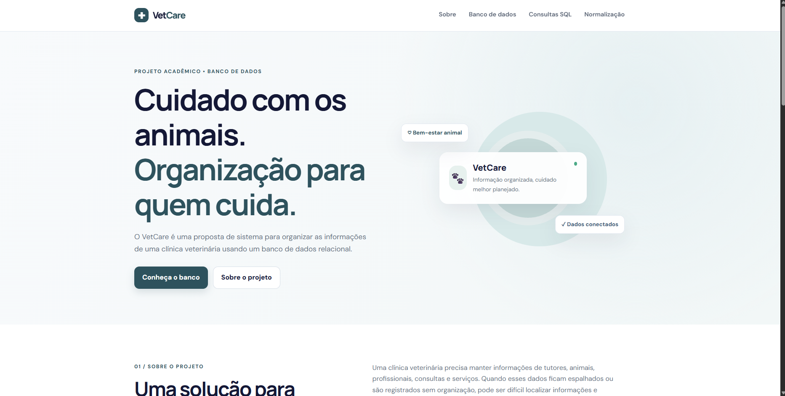
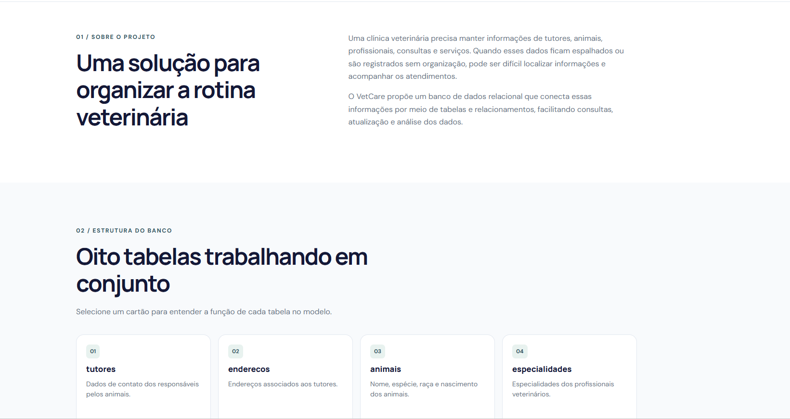
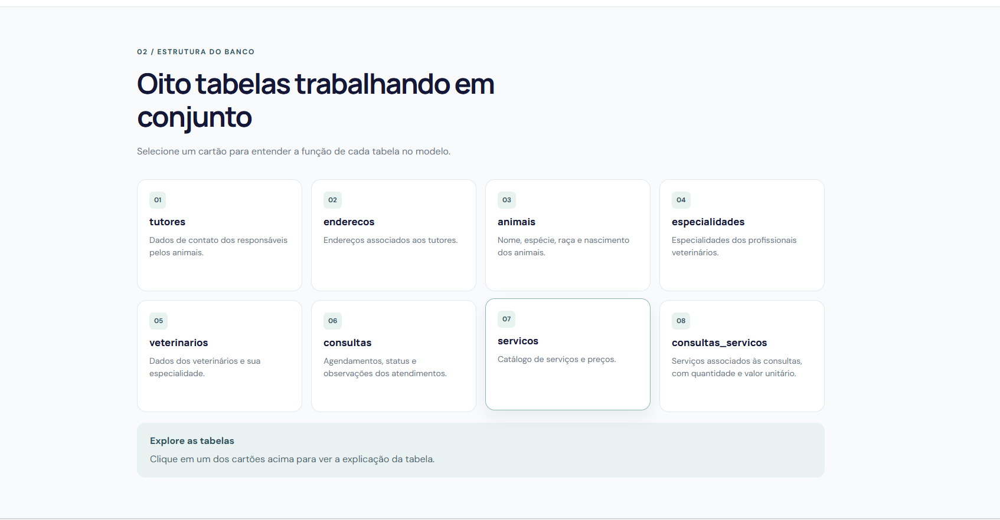
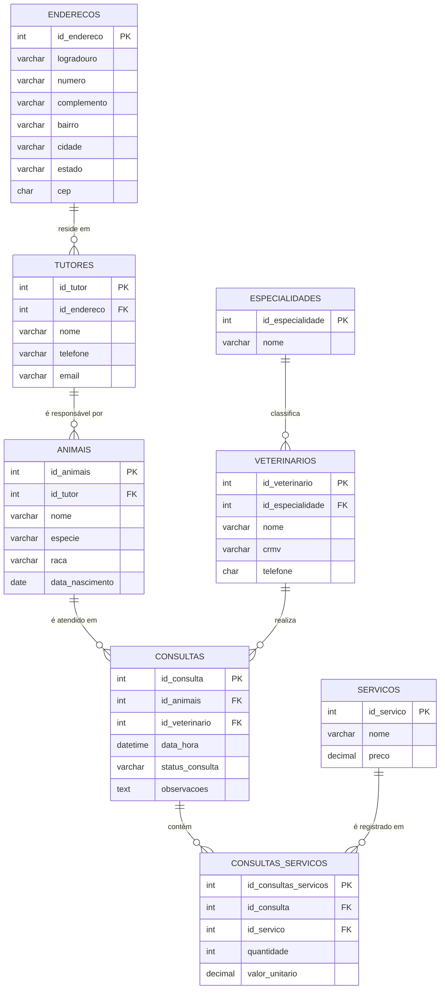

# 🐾 VetCare — Banco de Dados para Clínica Veterinária


Modelagem e implementação de um banco de dados relacional para uma **clínica veterinária**, cobrindo o cadastro de tutores e animais, o agendamento de consultas, o corpo clínico por especialidade e o registro dos serviços prestados em cada atendimento.

---

## Sumário

- [Sobre o projeto](#-sobre-o-projeto)
- [Funcionalidades](#-funcionalidades)
- [Apresentação web](#-apresentação-web)
- [Modelo de dados](#-modelo-de-dados)
- [Dicionário de dados](#-dicionário-de-dados)
- [Normalização](#-normalização)
- [Estrutura do repositório](#-estrutura-do-repositório)
- [Como executar](#-como-executar)
- [Consultas disponíveis](#-consultas-disponíveis)
- [Conceitos de SQL aplicados](#-conceitos-de-sql-aplicados)
- [Melhorias futuras](#-melhorias-futuras)
- [Autor](#-autor)

---

## Sobre o projeto

O **VetCare** responde a perguntas do dia a dia de uma clínica veterinária:

- Quem é o tutor de cada animal?
- Quais consultas já foram realizadas e quais estão agendadas?
- Qual veterinário atendeu cada caso e qual é a sua especialidade?
- Quais serviços foram prestados e quanto cada atendimento custou?

O projeto reúne o **script de criação** das tabelas (DDL), uma **carga inicial de dados** (DML) e **15 consultas** (DQL) que exploram desde filtros simples até junções múltiplas, agregações e subconsultas.

## Funcionalidades

-  Cadastro de **tutores** com endereço, telefone e e-mail
-  Cadastro de **animais** (espécie, raça e data de nascimento) vinculados a um tutor
-  Cadastro de **veterinários** com CRMV e especialidade
-  Registro de **consultas** com data/hora, status e observações
-  Catálogo de **serviços** com preço (consulta, vacinação, exames etc.)
-  Associação de serviços a cada consulta, com **quantidade e valor unitário** praticado no momento do atendimento

##  Apresentação web

Como complemento ao banco, o projeto conta com uma **página de apresentação** que explica a proposta de forma visual e interativa. Ela está organizada em quatro seções:

| Seção | Conteúdo |
|---|---|
| **01 · Sobre o projeto** | O problema de manter dados de clínica espalhados e a proposta de um banco relacional |
| **02 · Estrutura do banco** | Cartões interativos que explicam a função de cada uma das 8 tabelas |
| **03 · Consultas SQL** | Exemplos de `INNER JOIN`, `WHERE + LIKE` e `GROUP BY + COUNT` |
| **04 · Organização dos dados** | Explicação das formas normais (1FN a 4FN) |

🔗 **Acesse:** [vetcarebcd.vercel.app](https://vetcarebcd.vercel.app/)

<p align="center">
  
</p>

<details>
<summary>Ver mais prints da página</summary>




</details>

> Os exemplos de SQL da página são demonstrativos. As 15 consultas completas e testadas estão em [`consultas.sql`](consultas.sql).

## Modelo de dados

Versão em texto (renderizada automaticamente pelo GitHub):



### Relacionamentos

| Relacionamento | Cardinalidade | Descrição |
|---|---|---|
| `enderecos` → `tutores` | 1 : N | Um endereço pode ser associado a vários tutores |
| `tutores` → `animais` | 1 : N | Um tutor pode ter vários animais |
| `animais` → `consultas` | 1 : N | Um animal pode ter várias consultas |
| `veterinarios` → `consultas` | 1 : N | Um veterinário realiza várias consultas |
| `especialidades` → `veterinarios` | 1 : N | Uma especialidade agrupa vários veterinários |
| `consultas` ↔ `servicos` | N : N | Resolvido pela tabela associativa `consultas_servicos` |

##  Dicionário de dados

<details>
<summary><strong>enderecos</strong></summary>

| Coluna | Tipo | Restrições |
|---|---|---|
| id_endereco | INT | PK, AUTO_INCREMENT |
| logradouro | VARCHAR(100) | NOT NULL |
| numero | VARCHAR(10) | NOT NULL |
| complemento | VARCHAR(100) | NOT NULL |
| bairro | VARCHAR(100) | NOT NULL |
| cidade | VARCHAR(50) | NOT NULL |
| estado | VARCHAR(50) | NOT NULL |
| cep | CHAR(9) | — |

</details>

<details>
<summary><strong>tutores</strong></summary>

| Coluna | Tipo | Restrições |
|---|---|---|
| id_tutor | INT | PK, AUTO_INCREMENT |
| id_endereco | INT | FK → enderecos, NOT NULL |
| nome | VARCHAR(100) | NOT NULL |
| telefone | VARCHAR(10) | NOT NULL |
| email | VARCHAR(100) | NOT NULL |

</details>

<details>
<summary><strong>animais</strong></summary>

| Coluna | Tipo | Restrições |
|---|---|---|
| id_animais | INT | PK, AUTO_INCREMENT |
| id_tutor | INT | NOT NULL (referencia tutores) |
| nome | VARCHAR(50) | NOT NULL |
| especie | VARCHAR(20) | NOT NULL |
| raca | VARCHAR(30) | NOT NULL |
| data_nascimento | DATE | NOT NULL |

</details>

<details>
<summary><strong>especialidades</strong></summary>

| Coluna | Tipo | Restrições |
|---|---|---|
| id_especialidade | INT | PK, AUTO_INCREMENT |
| nome | VARCHAR(50) | NOT NULL |

</details>

<details>
<summary><strong>veterinarios</strong></summary>

| Coluna | Tipo | Restrições |
|---|---|---|
| id_veterinario | INT | PK, AUTO_INCREMENT |
| id_especialidade | INT | FK → especialidades, NOT NULL |
| nome | VARCHAR(100) | NOT NULL |
| crmv | VARCHAR(20) | NOT NULL |
| telefone | CHAR(10) | — |

</details>

<details>
<summary><strong>consultas</strong></summary>

| Coluna | Tipo | Restrições |
|---|---|---|
| id_consulta | INT | PK, AUTO_INCREMENT |
| id_animais | INT | FK → animais, NOT NULL |
| id_veterinario | INT | FK → veterinarios, NOT NULL |
| data_hora | DATETIME | NOT NULL |
| status_consulta | VARCHAR(20) | — (`Realizada`, `Agendada`) |
| observacoes | TEXT | — |

</details>

<details>
<summary><strong>servicos</strong></summary>

| Coluna | Tipo | Restrições |
|---|---|---|
| id_servico | INT | PK, AUTO_INCREMENT |
| nome | VARCHAR(50) | NOT NULL |
| preco | DECIMAL(10,2) | NOT NULL |

</details>

<details>
<summary><strong>consultas_servicos</strong></summary>

| Coluna | Tipo | Restrições |
|---|---|---|
| id_consultas_servicos | INT | PK, AUTO_INCREMENT |
| id_consulta | INT | FK → consultas, NOT NULL |
| id_servico | INT | FK → servicos, NOT NULL |
| quantidade | INT | NOT NULL |
| valor_unitario | DECIMAL(10,2) | NOT NULL |

> O `valor_unitario` é gravado na própria associação para preservar o preço cobrado na data do atendimento, mesmo que o preço do catálogo mude depois.

</details>

##  Normalização

O modelo foi estruturado seguindo as formas normais, que reduzem redundância e evitam anomalias de inserção, atualização e exclusão.

| Forma normal | Critério | Como o VetCare atende |
|---|---|---|
| **1FN** | Valores atômicos, sem listas na mesma célula | Cada campo guarda um único valor; o endereço, por exemplo, é dividido em logradouro, número, bairro, cidade etc. |
| **2FN** | Atributos dependem da chave primária completa | Todas as tabelas usam chave primária simples (`id_*`), então não há dependência parcial |
| **3FN** | Sem dependências transitivas | Dados de endereço, especialidade e serviço ficam em tabelas próprias, referenciadas por chave estrangeira |
| **4FN** | Sem dependências multivaloradas independentes | Relações N:N, como consulta e serviço, são resolvidas por tabela associativa (`consultas_servicos`) |

**Decisões de projeto**

- `consultas_servicos.valor_unitario` repete, de propósito, o preço do catálogo: ele registra o valor cobrado **na data do atendimento**, preservando o histórico mesmo que `servicos.preco` mude.
- Em `enderecos`, `cidade` e `estado` poderiam, num modelo mais rigoroso, sair para tabelas próprias (já que o CEP determina esses dados). Optou-se por manter a tabela simples para este escopo acadêmico.

## 📂 Estrutura do repositório

```
vetcare/
├── criacaoTabelas.sql     # DDL: cria o banco vetcare_bd e as 8 tabelas
├── insercao_dados.sql     # DML: popula as tabelas com dados de exemplo
├── consultas.sql          # DQL: 15 consultas de exemplo
├── docs/
│   ├── diagrama-er.png            # Diagrama entidade-relacionamento
│   └── apresentacao-*.png         # Prints da página de apresentação
└── README.md
```

##  Como executar

### Pré-requisitos

- [MySQL](https://dev.mysql.com/downloads/) 8.0+ (ou MariaDB compatível)
- Um cliente SQL, como **MySQL Workbench**, DBeaver ou o terminal `mysql`

### Passo a passo

**1. Clone o repositório**

```bash
git clone https://github.com/<seu-usuario>/vetcare.git
cd vetcare
```

**2. Crie o banco e as tabelas**

```bash
mysql -u root -p < criacaoTabelas.sql
```

**3. Insira os dados de exemplo**

```bash
mysql -u root -p < insercao_dados.sql
```

**4. Execute as consultas**

```bash
mysql -u root -p < consultas.sql
```

>  No **MySQL Workbench**, basta abrir cada arquivo em uma aba (`File > Open SQL Script`) e executar com `Ctrl + Shift + Enter`, respeitando a ordem acima.

##  Consultas disponíveis

O arquivo [`consultas.sql`](consultas.sql) traz 15 consultas, cada uma com seu contexto documentado em comentário.

| # | Consulta | Técnica principal |
|---|---|---|
| 1 | Animais e seus tutores | `INNER JOIN` |
| 2 | Animais de uma espécie (gatos) | `WHERE` |
| 3 | Tutores cujo nome começa com "A" | `LIKE 'A%'` |
| 4 | Consultas em um período (20 a 28/10/2026) | Filtro por intervalo de datas |
| 5 | Serviços entre R$ 50 e R$ 120 | `BETWEEN` |
| 6 | Consultas com animal e veterinário | `INNER JOIN` múltiplo |
| 7 | Veterinários e suas especialidades | `INNER JOIN` |
| 8 | Serviços de cada consulta, com total por item | 4 tabelas + cálculo |
| 9 | Serviços que contêm a palavra "consulta" | `LIKE '%...%'` |
| 10 | Quantidade de consultas por veterinário | `LEFT JOIN` + `COUNT` + `GROUP BY` |
| 11 | Valor total de cada item | Expressão aritmética |
| 12 | Total faturado por consulta | `SUM` + `GROUP BY` |
| 13 | Total geral dos serviços registrados | `SUM` |
| 14 | Serviços acima do preço médio | Subconsulta com `AVG` |
| 15 | Quantidade de animais por espécie | `COUNT` + `GROUP BY` |

### Exemplo

Total cobrado por consulta (Consulta 12):

```sql
SELECT
    c.id_consulta,
    a.nome AS animal,
    SUM(cs.quantidade * cs.valor_unitario) AS total_consulta
FROM consultas c
INNER JOIN animais a
    ON c.id_animais = a.id_animais
INNER JOIN consultas_servicos cs
    ON c.id_consulta = cs.id_consulta
GROUP BY c.id_consulta, a.nome
ORDER BY total_consulta DESC;
```

##  Conceitos de SQL aplicados

- **DDL:** `CREATE DATABASE`, `CREATE TABLE IF NOT EXISTS`, `AUTO_INCREMENT`, chaves primárias e estrangeiras
- **DML:** `INSERT INTO ... VALUES` em múltiplas linhas
- **Junções:** `INNER JOIN` e `LEFT JOIN`
- **Filtros:** `WHERE`, `LIKE`, `BETWEEN`, comparação de datas
- **Agregações:** `COUNT`, `SUM`, `AVG`, `GROUP BY`
- **Subconsultas:** comparação com valor agregado
- **Modelagem:** normalização, relacionamento 1:N e N:N com tabela associativa

## 👩‍💻 Autor

[Iris Caetano](https://github.com/Iris-Caetano)


